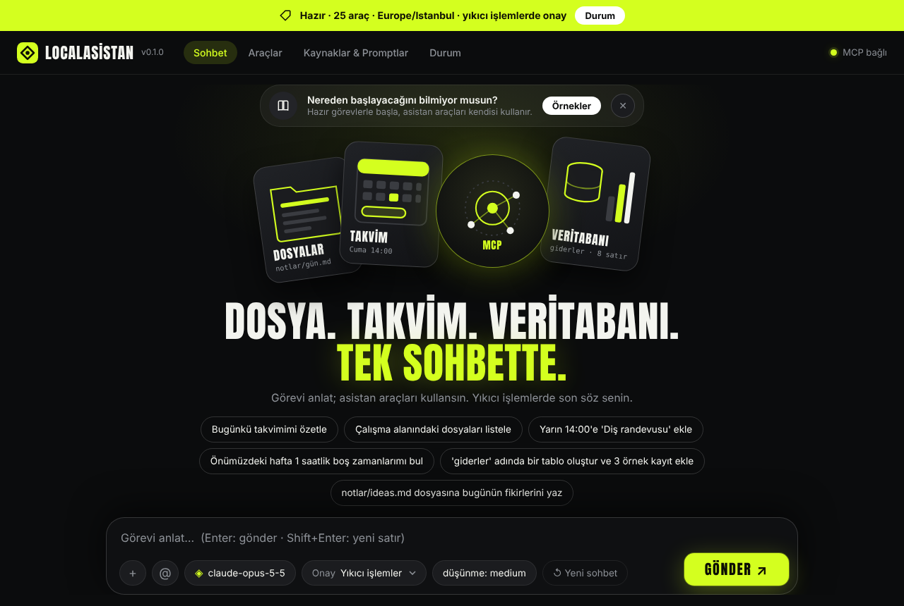
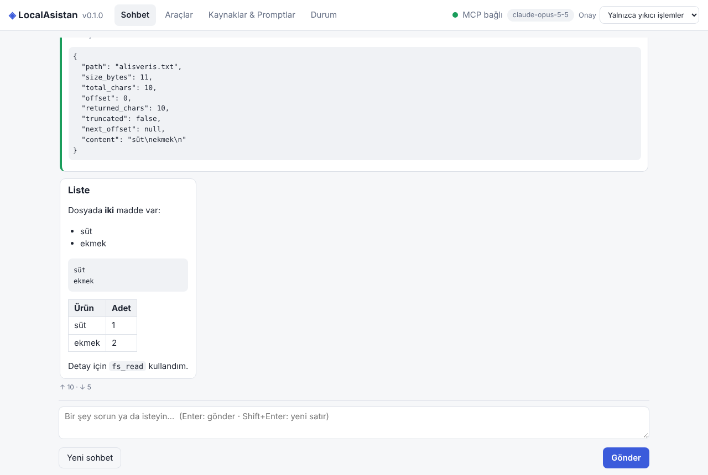
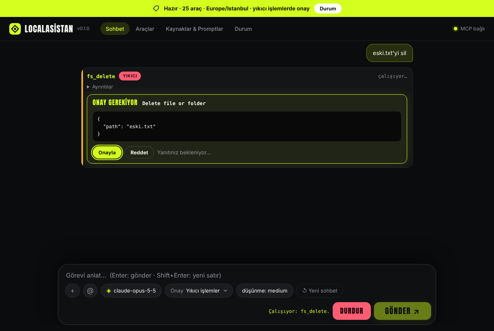
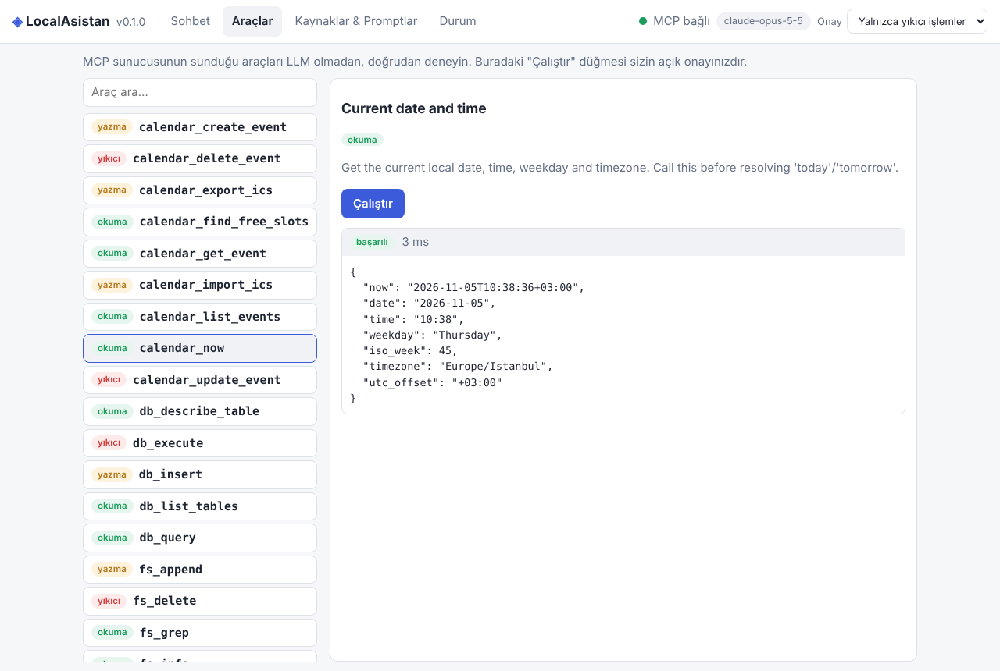

# LocalAsistan — Kendi MCP Sunucusu ve İstemcisi

Yerel **dosya**, **takvim** ve **veritabanı** araçlarını bir LLM'e (Claude) [Model Context Protocol](https://modelcontextprotocol.io)
üzerinden açan, baştan sona kendi yazdığımız bir uygulama: **MCP sunucusu** + **MCP istemcisi / ajan döngüsü** + **basit web arayüzü**.
Mac'te tek komutla çalışır; dışarıya yalnızca LLM çağrısı çıkar, veriniz makinenizde kalır.



| Sohbet (araç çağrıları, markdown) | Yıkıcı işlemde onay | Araçlar sekmesi (LLM'siz deneme) |
|---|---|---|
|  |  |  |

## Özellikler

- **MCP sunucusu** (`python -m localasistan.server`, stdio): **25 araç** (dosya 11 · veritabanı 5 · takvim 9), **5 kaynak/şablon**, **3 prompt**.
  Her araç `readOnly / destructive / idempotent` annotation'ı taşır. Eski ve yeni MCP el sıkışmalarını konuşur; Claude Desktop gibi başka istemcilerle de çalışır.
- **MCP istemcisi + ajan döngüsü:** sunucuyu alt süreç olarak başlatır, araçları Claude'a verir, akışlı yanıt, araç çağrısı, onay, hata ve iptal durumlarını yönetir.
  Sunucu çökerse sonraki çağrıda kendini toparlar.
- **Web arayüzü** (build adımsız, bağımlılıksız): Sohbet · Araçlar (LLM'siz elle çağırma) · Kaynaklar & Promptlar · Durum.
  Siyah zemin üzerinde fosforlu sarı vurgu; yüzen mesaj kutusunda **`+`** (örnek görevler ve MCP promptları) ve **`@`** (çalışma alanından dosya ekle)
  menüleri, üstte durum şeridi, başlık yazı tipi (Anton, OFL) uygulamayla birlikte gelir (internet gerekmez). Mobil uyumlu, `prefers-reduced-motion` destekli.
- **Güvenlik:** dosya sandbox'ı, salt-okunur SQL, yıkıcı işlemler için onay, yerel-ürün web güvenliği (aşağıda).
- **Takvim:** saat dilimi/DST doğru, çakışma denetimli, boş zaman bulma, `.ics` içe/dışa aktarım (Apple Takvim ile uyumlu).
- **Türkçe duyarlı:** `ÇALIŞMA` ↔ `çalışma` ve `İ/I/ı/i` aramalarda eşleşir; dosya adlarındaki Türkçe karakterler macOS'ta (NFD/NFC) doğru çalışır.

## Hızlı başlangıç (macOS)

Gereksinim: **Python 3.11+** (yoksa: `brew install python@3.12` ya da `brew install uv`) ve — yalnızca bu uygulamanın kendi sohbet arayüzü için —
bir [Anthropic API anahtarı](https://console.anthropic.com). Anahtarınız yoksa bkz. [API anahtarı olmadan kullanım](#api-anahtarı-olmadan-kullanım).

```bash
git clone https://github.com/ZEYDLCN/LocalAsistanMcp.git && cd LocalAsistanMcp
./scripts/setup.sh            # sanal ortam + bağımlılıklar + .env + kurulum denetimi
open -e .env                  # ANTHROPIC_API_KEY=sk-ant-... satırını doldurun
./scripts/run.sh              # arayüz açılır: http://127.0.0.1:8765
```

Finder'dan başlatmak için `scripts/LocalAsistan.command` dosyasına çift tıklayabilirsiniz.

İlk denemeyi kolaylaştırmak için örnek veri (dosyalar, takvim olayları, `giderler`/`kisiler` tabloları):

```bash
.venv/bin/localasistan seed
open ~/.localasistan/workspace     # asistanın dosya alanını Finder'da görün
```

Dosya alanını Finder'da kolay erişilen bir yere taşımak isterseniz `.env` içine `LOCALASISTAN_WORKSPACE=~/Documents/LocalAsistan` yazın.

Kurulumu doğrulamak için (ikincisi **iki gerçek API çağrısı** yapar: bağlantı ve araç çağırma denemesi; birkaç bin token tutar):

```bash
.venv/bin/localasistan doctor
.venv/bin/localasistan doctor --llm
```

> **İlk canlı deneme notu:** Bu proje geliştirilirken gerçek bir Anthropic anahtarı kullanılamadı; LLM katmanı gerçek SDK + sahte HTTP ile
> doğrulandı (istek gövdesi, başlıklar, SSE ayrıştırma, düşünme bloklarının geri yansıtılması). `doctor --llm` bu yüzden ilk canlı smoke testinizdir.
> Bir API hatası görürseniz mesaj arayüzde/terminalde açıkça yazar; sunucu tarafı yedek model kaynaklı ise `LOCALASISTAN_REFUSAL_FALLBACK=0` deneyin.

### API anahtarı olmadan kullanım

MCP sunucusu bağımsızdır; LLM'i başka bir istemci sağlayabilir. Anahtar gerektirmeyen yollar:

| Yol | LLM | Nasıl |
|---|---|---|
| **Claude Desktop** | Claude hesabınız | [aşağıda](#claude-desktop-ve-diğer-mcp-istemcileri-ile-kullanma) |
| **Claude Code** | Claude hesabınız | `claude mcp add localasistan -- $(pwd)/.venv/bin/python -m localasistan.server` |
| **NVIDIA ücretsiz API'si (GLM vb.)** | NVIDIA'nın barındırdığı model | [aşağıda](#nvidia-ücretsiz-apisi-glm-ve-diğer-openai-uyumlu-sağlayıcılar) |
| **Araçlar sekmesi** (`./scripts/run.sh`) | yok | Her aracı elle çalıştırın; “Çalıştır” düğmesi sizin onayınızdır |
| **Komut satırı** | yok | `.venv/bin/localasistan tools` · `.venv/bin/localasistan call calendar_now` · `call db_query sql="select * from giderler limit 5"` |

### NVIDIA ücretsiz API'si (GLM) ve diğer OpenAI uyumlu sağlayıcılar

Sohbet arayüzü Claude yerine `POST …/chat/completions` konuşan herhangi bir hizmetle de çalışır: NVIDIA (build.nvidia.com), OpenRouter, Groq,
yerel Ollama / vLLM / LM Studio. Model adını tahmin etmeyin; sunucudan listeleyin:

1. build.nvidia.com'a giriş yapıp bir model sayfasından API anahtarı oluşturun (`nvapi-…`).
2. `.env` dosyasına yazın:
   ```
   LOCALASISTAN_PROVIDER=openai_compat
   LOCALASISTAN_BASE_URL=https://integrate.api.nvidia.com/v1
   LOCALASISTAN_API_KEY=nvapi-...
   ```
3. Kendi bilgisayarınızdan model kimliklerini listeleyin ve çıkan adı `.env`'e `LOCALASISTAN_MODEL=` olarak yazın:
   ```bash
   .venv/bin/localasistan models --filter glm
   ```
4. Bağlantıyı **ve modelin araç çağırabildiğini** denetleyin (iki küçük istek yapar):
   ```bash
   .venv/bin/localasistan doctor --llm
   ```
   “araç çağırma denemesi” satırı ✓ ise model gerçek araç şemalarımızla geçerli bir çağrı üretti; ⚠ ise başka bir model deneyin.
5. `./scripts/run.sh` — üstteki çipte model adı görünür.

Yerel Ollama için: `LOCALASISTAN_BASE_URL=http://localhost:11434/v1`, anahtar gerekmez (düz `http` yalnızca `localhost` için kabul edilir; anahtar
varken uzak bir `http` adresi reddedilir).

**Bilmeniz gerekenler:**
- Ücretsiz katmanlar dakika başına istek sınırlıdır; sınıra takılınca uygulama kısa süre bekleyip en fazla iki kez yeniden dener ve bunu sohbette gösterir.
- Araç çağırma kalitesi modele göre değişir; onay mekanizması aynı çalışır ama zayıf bir model yanlış araç ya da argüman seçebilir (`doctor --llm` bunu ölçer).
- **Gizlilik:** araçların döndürdüğü her şey (dosya içeriği, takvim, veritabanı satırı) seçtiğiniz sağlayıcıya gider. Hizmetin veri kullanım koşullarını okuyun.
- Düşünme çabası ve sunucu tarafı yedek model yalnızca Claude içindir; bu sağlayıcıda geçerli değildir. Çıktı üst sınırı varsayılan 8192 token'dır (`LOCALASISTAN_MAX_TOKENS`).
- Doğrulama durumu: istek/yanıt biçimi, akış, araç çağırma, hata ve yeniden deneme sahte bir sunucuyla test edildi; gerçek NVIDIA uç noktasıyla ilk deneme sizde olacak.

### Örnek istekler

- “Bugünkü takvimimi özetle ve 1 saatlik odak zamanı öner”
- “Önümüzdeki hafta 45 dakikalık boş zamanlarımı bul; Salı 14:00'e ‘Sprint planlama’ ekle”
- “`notlar/alisveris.txt` dosyasında ne var? ‘kahve’ ekle”
- “Bu ay en çok hangi kategoride harcama yaptım?” (`giderler` tablosu)
- “‘projeler’ klasöründeki tüm .md dosyalarında ‘teslim’ geçen satırları bul”

## Mimari

```
┌──────────────── Tarayıcı (vanilla JS) ────────────────┐
│  Sohbet · Araçlar · Kaynaklar/Promptlar · Durum       │
└───────────────▲───────────────────────────────────────┘
                │ HTTP/JSON + SSE (yalnızca 127.0.0.1; Host/Origin/Content-Type denetimli)
┌───────────────┴──── localasistan ui (tek süreç) ──────┐
│  web/     Starlette API                               │
│  client/  ChatSession (ajan döngüsü) ──► Claude API   │
│           McpHub (yaşam döngüsü, yeniden bağlanma)    │
└───────────────▲───────────────────────────────────────┘
                │ MCP / JSON-RPC (stdio) — alt süreç: python -m localasistan.server
┌───────────────┴──── localasistan.server ──────────────┐
│  FileService      DatabaseService     CalendarService │
│  workspace/       userdata.db         calendar.db     │
└────────────────────────────────────────────────────────┘
```

```
src/localasistan/
  config.py sandbox.py errors.py textutil.py   çekirdek
  server/    files.py database.py calendar.py ics.py   servisler (MCP'den bağımsız)
             app.py                                      MCP araçları/kaynakları/promptları
  client/    hub.py catalog.py agent.py providers.py     MCP istemcisi + ajan döngüsü + Claude
             openai_compat.py                            OpenAI uyumlu sağlayıcı (NVIDIA, OpenRouter, Ollama…)
  web/       app.py security.py sse.py static/           arayüz
  cli.py seed.py doctor.py
```

Ayrıntılı plan, kararlar ve riskler: [`docs/PLAN.md`](docs/PLAN.md) · test stratejisi ve sonuçlar: [`docs/QA.md`](docs/QA.md).

## Araçlar

| Grup | Araç | Tür |
|---|---|---|
| **Dosya** (çalışma alanı içinde) | `fs_list` `fs_read` `fs_info` `fs_search` `fs_grep` | okuma |
| | `fs_write` (yalnızca **yeni** dosya) `fs_append` `fs_mkdir` `fs_move` | yazma |
| | `fs_overwrite` `fs_delete` | **yıkıcı** |
| **Veritabanı** (SQLite `userdata.db`) | `db_list_tables` `db_describe_table` `db_query` (salt-okunur SELECT) | okuma |
| | `db_insert` (yapılandırılmış, parametreli) | yazma |
| | `db_execute` (INSERT/UPDATE/DELETE/DDL) | **yıkıcı** |
| **Takvim** (`calendar.db`) | `calendar_now` `calendar_list_events` `calendar_get_event` `calendar_find_free_slots` | okuma |
| | `calendar_create_event` `calendar_export_ics` `calendar_import_ics` | yazma |
| | `calendar_update_event` `calendar_delete_event` | **yıkıcı** |

**Kaynaklar:** `calendar://today`, `calendar://week`, `db://schema`, `workspace://tree`, şablon `workspace://file/{+path}`.
**Promptlar:** `daily_briefing`, `summarize_file`, `schedule_meeting` (arayüzde “Sohbette kullan” ile sohbete aktarılır).

Araç açıklamaları ve hata mesajları LLM'e yönelik olduğundan İngilizcedir; arayüz ve dokümantasyon Türkçedir.

## Güvenlik modeli

| Tehdit | Önlem |
|---|---|
| LLM çalışma alanı dışına çıkmaya çalışır (`../`, mutlak yol, symlink, NUL) | `resolve()` tabanlı sandbox; kardeş klasör öneki, symlink ve dizin kaçışları engellenir |
| LLM dosyayı yanlışlıkla ezer / siler | `fs_write` yalnızca yeni dosya yaratır; `fs_overwrite`/`fs_delete` **yıkıcı** ve onaya bağlı; silme çöp kutusuz olduğundan açıkça işaretli |
| SQL ile veri bozma / sızdırma | `db_query` salt-okunur bağlantı + `sqlite3` authorizer; tek ifade; `ATTACH`/`PRAGMA`/`VACUUM INTO`/uzantı yükleme yasak; zaman, satır, uzunluk, boyut sınırı; takvim ayrı dosyada |
| Dosya/DB/etkinlik içindeki “prompt injection” | Sistem istemi içeriği *veri* sayar; yıkıcı işlemler onaylıdır; çıktılar boyut sınırlıdır |
| `fs_grep` ile ReDoS | Düz metin arama (regex yok) |
| Başka bir web sitesi yerel arayüzü kullanır (CSRF, DNS rebinding) | Yalnızca loopback; Host/Origin doğrulama; durum değiştiren isteklerde zorunlu `application/json`; CORS yok; katı CSP |
| XSS (model/araç çıktısı) | Tüm metin önce kaçışlanır; satır içi script/stil yok; `javascript:` bağlantıları çizilmez |
| API anahtarı sızıntısı | Alt sürece (MCP sunucusu) aktarılmaz; arayüz/loglarda gösterilmez |

**Onay politikası** (üstteki seçici ya da `LOCALASISTAN_APPROVAL`): `ask_destructive` (varsayılan: yalnızca yıkıcı araçlar) · `ask_writes` (yazan her araç) · `auto` (asla sormaz — dikkat).
Annotation'ı olmayan üçüncü taraf araçlar MCP şartnamesindeki en temkinli varsayılanla (yıkıcı) ele alınır.

## Yapılandırma

Ortam değişkenleri ya da `.env` (gerçek ortam değişkeni önceliklidir). Tam liste için bkz. [`.env.example`](.env.example).

| Değişken | Varsayılan | Açıklama |
|---|---|---|
| `ANTHROPIC_API_KEY` | — | Sohbet için gerekli (Araçlar sekmesi anahtarsız çalışır) |
| `LOCALASISTAN_PROVIDER` | `anthropic` | `anthropic` ya da `openai_compat` (NVIDIA, OpenRouter, Ollama…) |
| `LOCALASISTAN_BASE_URL` / `LOCALASISTAN_API_KEY` | — | `openai_compat` için kök adres (`…/v1`) ve anahtar; Ollama gibi yerel sunucular anahtar istemez |
| `LOCALASISTAN_MODEL` | `claude-opus-5-5` | Kullanılacak model (`openai_compat`'te zorunlu; adı `localasistan models` ile bulun) |
| `LOCALASISTAN_EFFORT` | `medium` | `low` · `medium` · `high` · `xhigh` · `max` |
| `LOCALASISTAN_REFUSAL_FALLBACK` | `1` | Güvenlik reddinde sunucu tarafı yedek model |
| `LOCALASISTAN_APPROVAL` | `ask_destructive` | Onay politikası |
| `LOCALASISTAN_HOME` | `~/.localasistan` | Veri klasörü (DB'ler burada) |
| `LOCALASISTAN_WORKSPACE` | `$LOCALASISTAN_HOME/workspace` | Dosya araçlarının hapsedildiği klasör, ör. `~/Documents/LocalAsistan` |
| `LOCALASISTAN_TZ` | sistemden | IANA saat dilimi, ör. `Europe/Istanbul` |
| `LOCALASISTAN_PORT` / `_HOST` | `8765` / `127.0.0.1` | Arayüz adresi |

## Komut satırı

```
localasistan ui [--port N] [--no-browser]   web arayüzü
localasistan chat                           terminalde sohbet (/yeni, /araclar, /cikis)
localasistan tools                          araç listesi
localasistan call fs_read path=notlar/x.md  LLM'siz araç çağrısı  (ya da --json '{"path": "..."}')
localasistan seed [--force]                 örnek veri
localasistan doctor [--llm]                 kurulum denetimi (+ gerçek API ve araç çağırma denemesi)
localasistan models [--filter glm]          openai_compat sunucusundaki model kimliklerini listele
localasistan config | desktop-config | server
```

## Claude Desktop (ve diğer MCP istemcileri) ile kullanma

Sunucu bağımsız bir MCP sunucusudur. Yapılandırma parçasını üretin:

```bash
.venv/bin/localasistan desktop-config
```

Çıktıyı `~/Library/Application Support/Claude/claude_desktop_config.json` içine ekleyin (dosyada başka sunucular varsa üzerine yazmayın; yalnızca
`"localasistan": {…}` bloğunu mevcut `mcpServers` içine koyun). Ardından Claude Desktop'u **Cmd+Q ile tamamen kapatıp** yeniden açın.
Bu durumda onay, istemcinin kendi araç-onay akışıyla yapılır; sunucudaki annotation'lar ona rehberlik eder.
Çalışma alanı `~/Documents` altındaysa macOS dosya iznini Terminal'e değil **Claude Desktop'a** verin. Araçlar görünmezse Desktop'un
Ayarlar → Geliştirici bölümündeki `localasistan` günlüğüne bakın.

## Takvim notları

- Zamansız (`2026-11-06T14:00`) girdiler **sizin saat diliminizde** yorumlanır; çıktı ofsetli ISO 8601'dir. DST'de olmayan yerel saatler (ör. 02:30) ileri normalleştirilir.
- **Tüm-gün** olaylarda bitiş tarihi *dahildir* (6–8 Kasım ⇒ `end=2026-11-08`).
- Çakışma denetimi yalnızca *zamanlı* olaylar arasındadır; çift rezervasyon varsayılan olarak reddedilir (`allow_conflicts` ile kullanıcı onayıyla aşılır).
- **Apple Takvim'den içe aktarma:** Takvim.app → Dosya → Dışa Aktar → *Takvim Dışa Aktar…* ile `.ics` alın, çalışma alanına koyun, sohbette “`takvim.ics` dosyasını içe aktar” deyin.
  Tekrarlayan (RRULE) olaylar şimdilik atlanır ve sayılarak raporlanır.

## Geliştirme ve test

```bash
make setup        # sanal ortam + test araçları        make test    # birim+entegrasyon+stdio (~2 dk)
make lint         # ruff                                make e2e     # tarayıcı testleri
make cov          # kapsama raporu                      make qa      # lint + test (CI için)
.venv/bin/playwright install chromium    # e2e için ilk kez (Mac)
```

Test katmanları: servis birim testleri · süreç-içi ve **gerçek stdio** MCP testleri · ajan döngüsü (sahte LLM) · gerçek Anthropic SDK + sahte HTTP ·
Starlette API/güvenlik · gerçek uvicorn ile SSE/onay/bağlantı kopması · gerçek `ui` süreci · Playwright (Chromium) arayüz testleri. Ayrıntı: [`docs/QA.md`](docs/QA.md).

## Sorun giderme

| Belirti | Çözüm |
|---|---|
| `Hata: 127.0.0.1:8765 kullanımda` | `localasistan ui --port 8766` |
| “MCP bağlı değil” (kırmızı nokta) | Durum sekmesi → *MCP sunucusunu yeniden başlat*; `localasistan doctor` çıktısına bakın |
| Sohbet kapalı uyarısı | `.env` içine `ANTHROPIC_API_KEY` yazıp yeniden başlatın |
| API `400` ve “fallbacks/beta” içeren mesaj | `LOCALASISTAN_REFUSAL_FALLBACK=0` |
| `~/Documents` altındaki çalışma alanında izin hatası | Sistem Ayarları → Gizlilik ve Güvenlik → Dosyalar ve Klasörler'de Terminal'e izin verin |
| `python3` 3.9 görünüyor | `brew install python@3.12` veya `brew install uv`, ardından `./scripts/setup.sh` |

## Kapsam dışı / bilinen sınırlar

Tekrarlayan takvim olayları (`.ics`'te atlanır) · Takvim.app/EventKit canlı entegrasyonu · çok kullanıcılı/uzak erişim ve kimlik doğrulama (arayüz yalnızca yerel) ·
birden çok MCP sunucusu birleştirme · sohbet geçmişinin diske kalıcılığı (bellek içi, son 20 oturum) · uzun sohbetlerde otomatik bağlam sıkıştırma.
